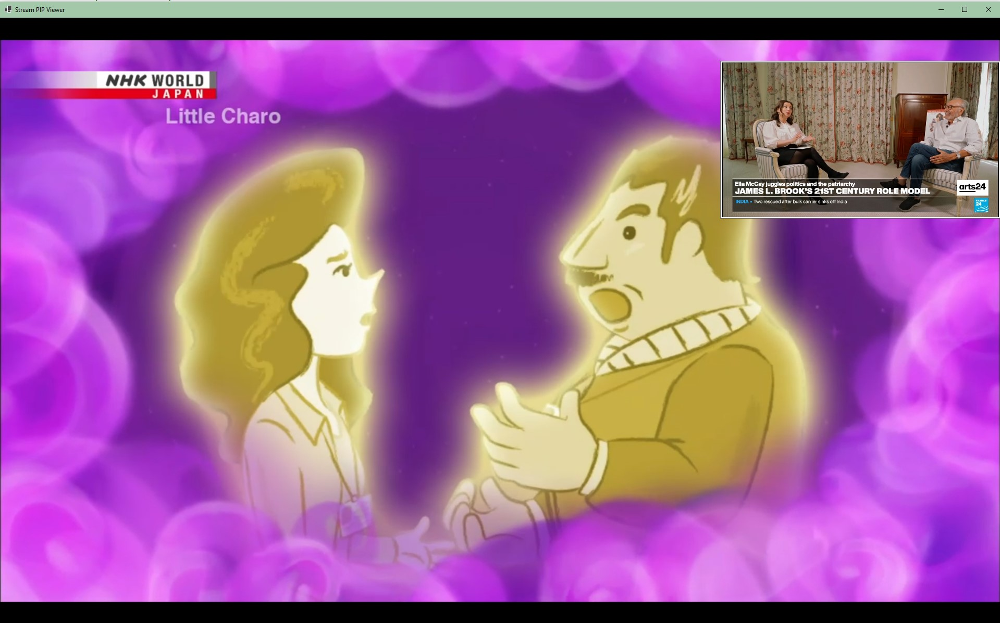

# Stream PIP Viewer

Stream PIP Viewer is a lightweight desktop application for displaying two RTSP/H.264 feeds with a main view and a picture-in-picture overlay. Originally developed to preview CCTV streams, but can be used to present any rtsp from the web.

The app was built to prioritize low CPU usage and good image quality. It uses native video playback instead of converting camera feeds to MJPEG or pushing raw frames through the application.
Each stream runs in its own `CctvPip.StreamHost` process, and the main app embeds those helper windows into the MainWindow and PIP surfaces. This keeps audio state isolated per stream when the native playback backend exposes process-wide audio behavior.



## Purpose

The application is intended for a monitoring screen where two CCTV feeds should stay visible at the same time:

- `CCTV1` starts as the main full-size feed.
- `CCTV2` starts as the smaller PIP feed.
- Both streams start muted.
- Feeds can be swapped at runtime.
- PIP position, size, and border color are configurable.
- PIP border size is configurable from 0 to 100 px.

## Host Architecture

The application has two executable projects:

- `CctvPip.App` is the shell application. It owns the main window, PIP layout, context menu, fullscreen behavior, settings dialog, config file, and MainWindow/PIP role mapping.
- `CctvPip.StreamHost` is a single-stream player. One process is launched for `CCTV1`, and a second process is launched for `CCTV2`.

The main app starts each host with `--hosted`, finds the host window by process ID, embeds that window into the matching video surface, and sends mute, unmute, restart, and shutdown commands to that process.

Embedded stream hosts are excluded from the taskbar and Alt+Tab, leaving one entry
for the main viewer. Hosts launched without `--hosted` remain normal diagnostic windows.

This design exists because some native playback backends can share audio behavior inside one process. Isolating each stream into its own process makes `Mute Main Stream`, `Mute PIP Stream`, `Mute All`, and `Unmute All` behave independently.

Hosted startup is equivalent to:

```powershell
CctvPip.StreamHost.exe --hosted --stream cctv1 --label CCTV1 --config "path\to\cctv-pip.properties"
CctvPip.StreamHost.exe --hosted --stream cctv2 --label CCTV2 --config "path\to\cctv-pip.properties"
```

## Default Streams

Stream URLs example:

```properties
cctv1.url=rtsp://192.168.0.999:554/cam/realmonitor?channel=1&subtype=0&unicast=true&proto=Onvif
cctv2.url=rtsp://192.168.0.998:554/cam/realmonitor?channel=1&subtype=0&unicast=true&proto=Onvif
```

The defaults use `subtype=0`, which is the higher-quality stream for these cameras.

## Controls

Right-click the video window to open the context menu:

```text
Reconnect
Settings
----------
Mute All
Unmute All
----------
Unmute Main Stream / Mute Main Stream
Unmute PIP Stream / Mute PIP Stream
----------
Swap feeds
Fullscreen / Exit Fullscreen
```

Audio controls:

- `Mute All` mutes both streams.
- `Unmute All` unmutes both streams.
- `Unmute Main Stream / Mute Main Stream` toggles the stream currently displayed in the main video area.
- `Unmute PIP Stream / Mute PIP Stream` toggles the stream currently displayed in the PIP overlay.
- Mute state follows the stream through reconnects and source reloads during the current app session.
- Main/PIP audio commands are sent to separate stream-host processes so muting or unmuting one stream does not change the other stream.

Other controls:

- `Reconnect` restarts only the stream under the original right-click, in the main view or PIP. It follows feed swaps and preserves that stream's mute state.
- Double-click the main video area to enter/exit fullscreen.
- Double-click the PIP video to swap feeds.
- Press `Esc` to exit fullscreen.

## Settings

Open `Settings` from the context menu. The dialog uses the Windows system colors.

Available settings:

- CCTV1 source URL.
- CCTV2 source URL.
- PIP size with synchronized slider and percentage input.
- PIP left margin as a percentage of the main video width.
- PIP top margin as a percentage of the main video height.
- PIP border color as a six-digit RGB hex value, a color swatch, and a color picker.

The toolbar provides, from left to right:

- Open the folder containing the active properties file.
- Reload dialog values from the current file on disk.
- Export a backup `.properties` file using the values currently displayed. Other
  settings and comments come from the latest active file on disk.
- Import dialog values from another `.properties` file. Missing values keep their
  current control values; settings without controls are ignored.

The file path in the bottom status bar opens the active file in Notepad when clicked.
Border thickness remains configurable through `pip.border.size` in the properties file.

Settings behavior:

- PIP size, position, border color, and border size preview immediately in the main window.
- Source URL and setting changes are written to config only after clicking `Save`.
- `Cancel` restores the config-backed view and does not write changes.
- If either source URL changes on `Save`, both streams reload.
- Import and reload update controls and previews without writing the active file.
- Export never replaces the active configuration. Save preserves settings without
  controls, including any changes to them made on disk while the dialog was open.
- Valid RGB hex text updates the swatch immediately. Invalid text reverts to the
  last valid color when focus leaves the field.

PIP position uses the top-left corner of the main video area as its origin, excluding
black letterbox bars. `Left (%) = 10` and `Top (%) = 10` place PIP at `(100, 50)` in a
1000 x 500 video area, or `(200, 100)` in a 2000 x 1000 area. Position and size follow
window resizing, fullscreen, and monitor changes. PIP stays fully inside the video
area; temporary clamping does not change your chosen percentages.

Older `pip.x` / `pip.y` pixel settings are converted once using the initial video
area size. Existing percentage settings take precedence. After conversion, the old
pixel keys are removed. Configurations that already have percentage settings are
also cleaned up automatically on startup.

## Config File

The app creates or loads:

```text
cctv-pip.properties
```

Typical settings:

```properties
cctv1.url=rtsp://192.168.0.999:554/cam/realmonitor?channel=1&subtype=0&unicast=true&proto=Onvif
cctv2.url=rtsp://192.168.0.998:554/cam/realmonitor?channel=1&subtype=0&unicast=true&proto=Onvif
pip.border.color=#FFFFFF
pip.border.size=2
pip.left.percent=70
pip.top.percent=4
pip.scale=0.28
reconnect.attempts=3
reconnect.delay.ms=1500
player.backend=libvlc
libvlc.options=--no-video-title-show,--avcodec-hw=any
cctv1.player.options=:rtsp-tcp,:network-caching=300,:live-caching=300
cctv2.player.options=:rtsp-tcp,:network-caching=300,:live-caching=300
```

Use `Open Config` in Settings to open the exact config file used by the running app.

## No-Signal And Reconnect Behavior

Each stream reconnects independently.

Before a stream connects:

```text
NO SIGNAL
```

If initial connection fails after retries:

```text
NO SIGNAL - Failed to connect
```

If a stream was live and later reconnect fails:

```text
NO SIGNAL. Reconnection failed
```

The app shows the stream label and a short technical error reason when available.

## Run

```powershell
dotnet run
```

Build:

```powershell
dotnet build
```

Building the main app also builds `CctvPip.StreamHost` and copies the helper executable to:

```text
bin\Debug\net8.0-windows\StreamHost\CctvPip.StreamHost.exe
```

The helper can also be launched directly for diagnostics.

## Versions And Releases

Set the three-part release version in `Directory.Build.props`, currently `1.0.2`.
`VersionRevisionOffset` is the total Git commit count of the first commit in that
version series, currently `21`. The build subtracts that offset from the current
commit count to produce `1.0.2.0`, `1.0.2.1`, and so on. Set the offset to the expected
commit count of the version-bump commit whenever starting a new series at `.0`.
The main app and stream host share this version. A new commit increments the fourth
number; rebuilding the same commit keeps it unchanged. Uncommitted edits retain the
current commit's version. The product version also includes the Git commit hash.

Build from a checkout with full Git history (`git fetch --unshallow` for a shallow clone).
When building a source archive without Git, supply the revision explicitly:

```powershell
dotnet build -p:VersionRevision=0
```

Every push to `main` runs the Windows release workflow. A successful build creates a
matching tag such as `v1.0.2.0` and publishes `StreamPIPViewer-v1.0.2.0-windows.zip`
to GitHub Releases. The workflow can also be run manually on `main`; rerunning a
published version keeps its existing download.

After publication, the workflow keeps the latest release and two previous releases
(three total), deleting older releases and their downloads. Git tags remain available
as source history. Failed builds or uploads do not remove previous releases.

## Run Stream Hosts Directly

Build the app first:

```powershell
dotnet build
```

Then run a stream host as a normal standalone window by omitting `--hosted`:

```powershell
.\bin\Debug\net8.0-windows\StreamHost\CctvPip.StreamHost.exe --stream cctv1 --config ".\bin\Debug\net8.0-windows\cctv-pip.properties"
.\bin\Debug\net8.0-windows\StreamHost\CctvPip.StreamHost.exe --stream cctv2 --config ".\bin\Debug\net8.0-windows\cctv-pip.properties"
```

You can also provide a stream URL directly:

```powershell
.\bin\Debug\net8.0-windows\StreamHost\CctvPip.StreamHost.exe --label "Test Camera" --url "rtsp://camera.example/stream"
```

Useful host arguments:

- `--stream cctv1` or `--stream cctv2` selects which config keys to read.
- `--config <path>` reads stream URL, LibVLC options, and media options from a properties file.
- `--url <rtsp-url>` overrides the configured stream URL.
- `--label <text>` changes the window/status label.
- `--unmuted` starts the host with audio enabled. Without this flag, hosts start muted.
- `--libvlc-options <comma-separated-options>` overrides `libvlc.options`.
- `--media-options <comma-separated-options>` overrides the selected stream's media options.

Standalone host controls:

- Right-click opens the host context menu.
- `Mute` / `Unmute` toggles that one host process.
- `Restart` reloads that stream.
- Press `M` to toggle mute.
- Press `R` to restart playback.
